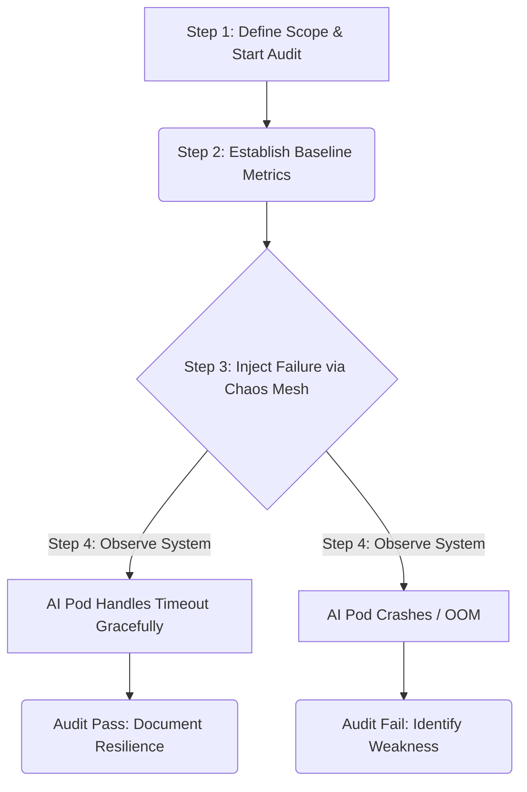
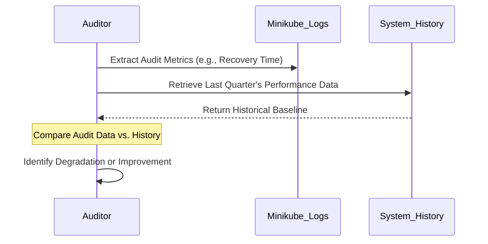
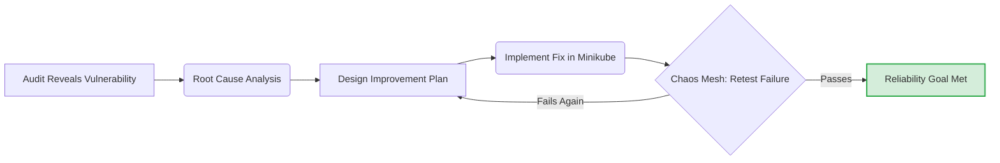

# Reliability Audits and Continuous Improvement

**Session Time:** 120 minutes

---

## Table of Contents
1. Explaining the Purpose and Process of Reliability Audits
2. Conducting Performance Reviews Using Key Metrics and Historical Data
3. Designing Continuous Improvement Plans Aligned with Reliability Goals
4. Lab: Failure Injection Exercise
5. Wrap-Up and Reflection

---

## Learning Objectives

By the end of this module, participants will be able to:

1. Explain the purpose and process of reliability audits.
2. Conduct performance reviews using key metrics and historical data.
3. Design continuous improvement plans aligned with reliability goals.

---

## Session Breakdown

| Segment | Topic                                         | Duration (minutes) |
|---------|-----------------------------------------------|--------------------|
| 1       | The Purpose and Process of Reliability Audits | 20                 |
| 2       | Conducting Performance Reviews                | 20                 |
| 3       | Designing Continuous Improvement Plans        | 20                 |
| 4       | Lab: Failure Injection Exercise               | 60                 |

---

## 1. Explaining the Purpose and Process of Reliability Audits

To maintain robust AI systems, you must learn to conduct reliability audits and develop continuous improvement cycles. A reliability audit is a proactive, structured evaluation of a system's ability to withstand failures. Instead of waiting for a real-world outage, audits deliberately stress the system to uncover hidden architectural weaknesses. We are now testing whether the fixes designed during previous incident response and load balancing labs actually work in practice.

### The Audit Process
1. **Define the Scope:** Identify the critical AI service to test.
2. **Establish the Baseline:** Note the normal operating metrics.
3. **Inject Failure:** Introduce a controlled anomaly (e.g., network latency or a crashed pod).
4. **Observe and Document:** Record how the system reacts and how long recovery takes.

### Tools Used: Chaos Mesh (local) and Minikube
We use **Chaos Mesh** running on a local **Minikube** cluster to safely perform these audits. Minikube provides the isolated Kubernetes environment, while Chaos Mesh acts as the failure injection tool, allowing you to orchestrate chaos experiments declaratively.

**Prerequisite Installation:**
To ensure Chaos Mesh interacts correctly with Minikube's container runtime, it must be installed using specific Helm flags:

```bash
helm repo add chaos-mesh [https://charts.chaos-mesh.org](https://charts.chaos-mesh.org)
helm install chaos-mesh chaos-mesh/chaos-mesh \
  --namespace=chaos-mesh --create-namespace \
  --set chaosDaemon.runtime=containerd \
  --set chaosDaemon.socketPath=/run/containerd/containerd.sock
```


### Practical Example
During an audit of your AI recommendation engine, you want to see what happens if the internal database connection becomes slow. You apply a `NetworkChaos` rule using Chaos Mesh to inject a 2-second delay into database requests within Minikube. You also add a `correlation: "25"` field so that only 25% of packets experience the correlated delay, simulating realistic, bursty network degradation rather than a flat pause.

**Crucial Warning:** The `labelSelectors` in your chaos experiment must exactly match the pod labels applied by your Deployment — verify with `kubectl get pods --show-labels` before running an experiment. A selector mismatch will cause the experiment to run silently without injecting any actual failure.





---

## 2. Conducting Performance Reviews Using Key Metrics and Historical Data

After an audit or an actual incident, you must conduct performance reviews using key metrics and historical data. You will use metrics and retrospectives to track performance and drive operational excellence.

### Concepts: Performance Reviews
* **Service Level Indicators (SLIs):** The actual measurements (e.g., 99% of AI inferences completed in <200ms).
* **Historical Data Analysis:** Comparing the current audit's recovery time to previous months to see if system resilience is trending up or down.

### Tools Used: Minikube (Logs/Events) and Chaos Mesh (Dashboards)
While Chaos Mesh injects the failure, you use `kubectl` commands within your Minikube environment to pull the historical event logs and metrics generated during the chaos experiment.

### Practical Example
You just completed a CPU stress test audit. You conduct a performance review by pulling the historical CPU utilization metrics from the previous 30 days and comparing them to the behavior during the Chaos Mesh experiment. If the historical data shows that the cluster usually scales up within 30 seconds, but during the test it took 3 minutes, you have identified a severe performance regression.




---

## 3. Designing Continuous Improvement Plans Aligned with Reliability Goals

The final step is to design continuous improvement plans aligned with reliability goals. Finding a vulnerability is useless unless it translates into a concrete plan to fix the system and prevent future recurrence.

### Concepts: The Continuous Improvement Cycle
* **Root Cause Analysis (RCA):** Determining exactly *why* the system failed the audit.
* **Action Items:** Specific, assignable tasks (e.g., "Update the AI Pod's memory limits," or "Implement a fallback cache").
* **Alignment:** Ensuring the fix directly supports your defined Service Level Objectives (SLOs).

### Tools Used: Minikube and Chaos Mesh (Validation)
You use Minikube to implement the architectural fix and then use Chaos Mesh to re-run the exact same failure experiment. This validates that your continuous improvement plan was successfully executed.

### Practical Example
Your performance review revealed that your AI inference API dropped 50% of traffic when a node failed. Your reliability goal is 99.9% uptime.
1. **Plan:** You design an improvement plan to implement a stricter `PodDisruptionBudget` and increase the minimum replica count.
2. **Execute:** You apply the new YAML configuration to Minikube.
3. **Validate:** You use Chaos Mesh to kill the node again. This time, the traffic drop is 0%. The loop is closed.




---

## 4. Lab: Failure Injection Exercise

**Objective:** Failure Injection Exercise – Simulate downtime with Chaos Mesh and document recovery results. Learners test resilience and learn how to strengthen fault tolerance in production environments.

> [!NOTE]
>
> [Lab: **Failure Injection Exercise**](https://git.generalassemb.ly/ai-systems-engineering-reliability/lab-15-failure-injection-exercise)
> 
> **Note**: Please refer to the dedicated [Lab Guide](https://git.generalassemb.ly/ai-systems-engineering-reliability/lab-15-failure-injection-exercise)
 for full instructions, architectural constraints, and deliverables.


---

## 5. Wrap-Up and Reflection

**Reflection Questions:**
1. How does utilizing Chaos Mesh to proactively simulate downtime change a team's approach from reactive firefighting to proactive engineering?
2. When designing a continuous improvement plan, why is it critical to validate your proposed fix using the exact same historical data and failure conditions that originally exposed the weakness?

---

## Resources

* [Chaos Mesh Official Documentation](https://chaos-mesh.org/docs/)
* [Minikube Handbook](https://minikube.sigs.k8s.io/docs/handbook/)
* [Google SRE Book: Continuous Improvement and Retrospectives](https://sre.google/sre-book/postmortem-culture/)

