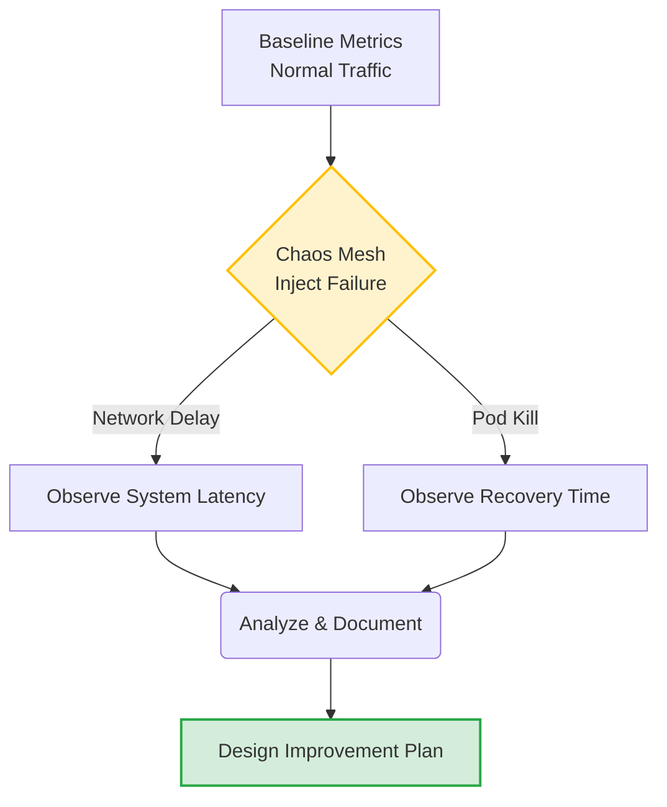

# Instructor Guide: Reliability Audits and Continuous Improvement

## Module Overview
In this module, instructors will guide learners to conduct reliability audits and develop continuous improvement cycles. The focus is on using metrics and retrospectives to track performance and drive operational excellence. This session shifts the mindset from reactive troubleshooting to proactive fault tolerance engineering.

## Learning Objectives
By the end of this session, learners will be able to:
* Explain the purpose and process of reliability audits.
* Conduct performance reviews using key metrics and historical data.
* Design continuous improvement plans aligned with reliability goals.

## Session Pacing Guide (120 Minutes total)

| Duration   | Segment                    | Instructor Action                                                                                                                                                                                                                 |
|:-----------|:---------------------------|:----------------------------------------------------------------------------------------------------------------------------------------------------------------------------------------------------------------------------------|
| **20 min** | **The Reliability Audit**  | Discuss the shift from reactive incident response to proactive chaos engineering. Explain the continuous improvement cycle and the blameless post-mortem culture.                                                                 |
| **40 min** | **Chaos Mesh Demo**        | Live demonstration: Deploy a simple pod to Minikube. Use Chaos Mesh to inject a network delay or pod kill. Show how to capture the metrics during the simulated outage.                                                           |
| **60 min** | **Lab: Failure Injection** | Facilitate the Failure Injection Exercise. Guide learners to simulate downtime with Chaos Mesh and document recovery results. Ensure they test resilience and learn how to strengthen fault tolerance in production environments. |

---

## Delivery Notes & Teaching Tips

### 1. Blameless Culture & Proactive Engineering
* **Simplifying Concepts:** 
  
  Frame a reliability audit as a "fire drill" for systems. We don't wait for a fire to find out if the alarm works. We test it proactively.

* **Learner Context:** 
  
  Emphasize that continuous improvement relies on psychological safety. If uncovering a system vulnerability leads to punishment, engineers will hide vulnerabilities. 

### 2. Visualizing Chaos Engineering
Draw or display how Chaos Mesh interacts with the Kubernetes cluster to validate reliability:

---

## Common Student Issues & Solutions

| Issue                                 | Potential Cause                                                                                   | Solution                                                                                                                                                             |
|:--------------------------------------|:--------------------------------------------------------------------------------------------------|:---------------------------------------------------------------------------------------------------------------------------------------------------------------------|
| **Chaos Mesh Dashboard Inaccessible** | Port-forwarding is not set up correctly in Minikube, or the Chaos Mesh pods are still pending.    | Instruct the learner to run `kubectl get pods -n chaos-mesh` to verify they are running, then restart the `kubectl port-forward` command.                            |
| **Failure Injection has no effect**   | The `selector` in the Chaos Mesh YAML does not match the labels of the target AI application pod. | Guide the student to compare `kubectl get pods --show-labels` with the `labelSelectors` defined in their `PodChaos` or `NetworkChaos` YAML file.                     |
| **System does not recover**           | The learner killed a pod that was not managed by a ReplicaSet or Deployment (e.g., a bare Pod).   | Explain that Kubernetes only auto-heals pods managed by controllers. Have them wrap their pod in a Deployment YAML and try the experiment again.                     |
| **Metrics are missing or flat**       | Minikube's metrics-server is disabled, or the historical data window is too narrow.               | Have the student enable the add-on: `minikube addons enable metrics-server`. Ensure they wait 1-2 minutes for data to populate before starting the chaos experiment. |

---

## Debrief Questions
1. "During the Failure Injection Exercise, what was the most surprising behavior your system exhibited when you simulated downtime with Chaos Mesh?"
2. "How does documenting recovery results  help a team design continuous improvement plans aligned with reliability goals?"
3. "Why is conducting performance reviews using historical data  more effective than just looking at a snapshot of the system during an active incident?"

---

## Resources for the Instructor
* **Reference:** 
  * [Chaos Mesh Official Documentation](https://chaos-mesh.org/docs/) - Guide to configuring and running chaos experiments.
  * [Google SRE Book: Postmortem Culture](https://sre.google/sre-book/postmortem-culture/) - Essential reading on learning from failure.
* **AI Prompt Bank:** Keep these handy to share with students who are stuck:
    * *"Write a Chaos Mesh `PodChaos` YAML configuration that randomly kills one pod labeled 'app=ai-service' every 5 minutes."*
    * *"Provide a template for an SRE blameless post-mortem document following an injected failure test."*